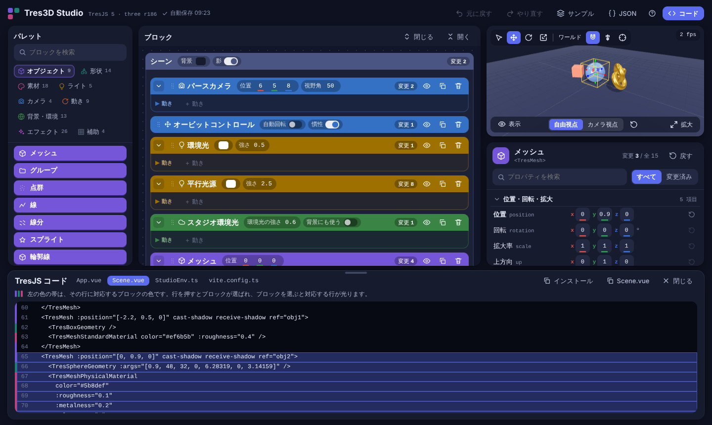

# Tres3D Studio

ブロックを積んで [TresJS](https://tresjs.org/) のシーンを組み立て、その場でプレビューできるツールです。
書き出したコードは、そのまま Vue + TresJS のプロジェクトで動きます。TresJS の非公式ツールです。



## 特徴

- **ブロックで組む**: メッシュ・ライト・カメラ・エフェクトなど約 100 種を、入れ子に積んで組み立てる
- **すぐ見える**: 右のプレビューに即時に反映。ギズモで動かし、数値欄はドラッグでも変えられる
- **コードが読める**: 「コード」で `App.vue` / `Scene.vue` などを書き出し。ブロックとコードの行が対応して光る
- **プロパティを網羅**: three.js・cientos・post-processing のプロパティを、ライブラリから自動で拾う
- **自動保存**: 編集内容はブラウザに保存され、次に開くと続きから使える

## はじめかた

Node.js 24 以上を推奨します（22.12 以上でも、ビルド・型確認・画面の動作を確認済みです）。

```bash
npm install
npm run dev      # 開発サーバー
npm run build    # dist/ に出力（静的ホスティングにそのまま置ける）
```

初めて開くと、4 つの手順の案内が出ます（上部の「？」でいつでも出せます）。

## 最短の使い方

1. 左のパレットからブロックをドラッグ（クリックでも追加）する
2. 形状・素材・動きは、ブロックの中の「＋」や空の受け口に入れる
3. ブロックを選び、右下のインスペクタで値を変える。プレビューのギズモ（W / E / R）でも動かせる
4. 上部の「コード」で、書き出されるコードを見る

## ドキュメント

- [使い方](docs/how-to-use.md): 操作の一覧、プレビュー、コードとの対応、書き出したコードの使い方、対応範囲、制約
- [開発](docs/development.md): スクリプト、ソースの構成、プロパティを網羅する仕組み

## ライセンス

[MIT](./LICENSE)
